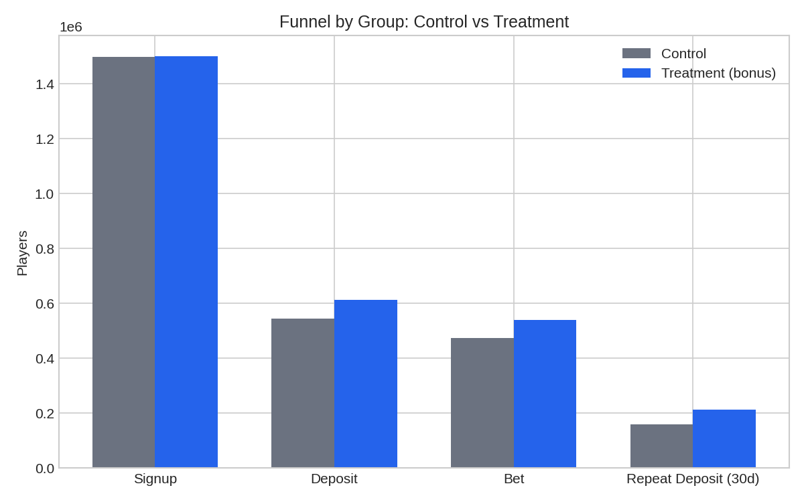
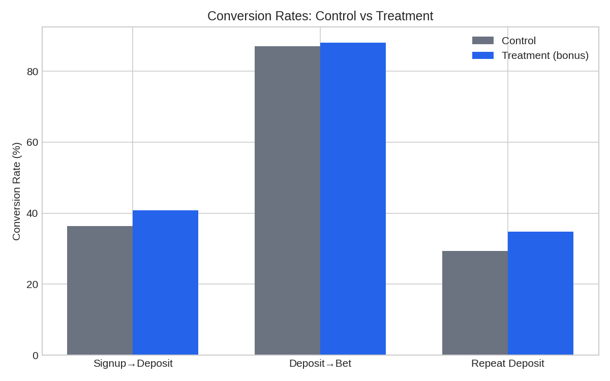
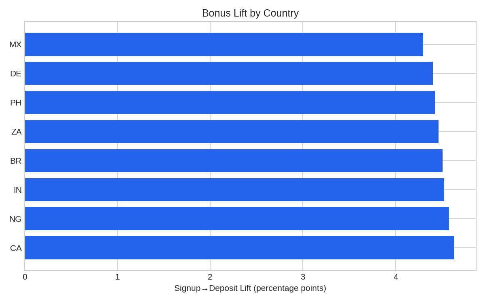

# 🎰 Bonus A/B Test & ROI Analysis — iGaming (Polars)

[](.github/workflows/ci.yml)
[](pyproject.toml)
[](https://pola.rs)
[](tests/)
[](LICENSE)

A production-shaped A/B test analytics toolkit: simulates and analyzes a
**first-deposit bonus campaign** (100% match, capped at $50) for a
fictional casino/sportsbook platform, on a **3,000,000-player dataset**.
Built as a tested, installable Python package with a CLI and an
interactive dashboard — not a one-off notebook.

> Portfolio project on synthetic data, built to demonstrate an iGaming
> product-analytics workflow end to end: experiment design, funnel
> analysis, statistical testing, ROI, and segmentation — the same
> workflow used to evaluate feature releases and promo campaigns.



## The question this answers

A deposit bonus almost always **increases conversion** — that's not
interesting on its own. The real question a Product Analyst has to
answer is: **does the incremental revenue it generates exceed what it
costs to give away?** This project is built around that question, not
around "did the metric go up."

## Key result

| Metric | Control | Treatment | Lift | p-value |
|---|---|---|---|---|
| Signup → Deposit | 36.30% | 40.77% | **+4.48pp** (+12.3% rel.) | < 0.001 |
| Repeat deposit (30d) | 29.34% | 34.83% | **+5.49pp** (+18.7% rel.) | < 0.001 |
| Avg. first deposit | $45.01 | $52.04 | **+$7.03** | < 0.001 |
| **Bonus ROI** | — | — | **0.36x** | bonus cost ($23.85M) > incremental volume ($8.63M) |

**Recommendation:** every funnel metric improves with strong statistical
significance — and a naive read stops there. But the bonus **doesn't pay
for itself as a blanket offer**. Segmentation shows the lift is
meaningfully higher in Canada, Nigeria, India, and on mobile — a
targeted rollout to those segments (rather than platform-wide) is the
better next experiment. See [`outputs/results_report.md`](outputs) for
the full breakdown, or run the dashboard to explore it interactively.

This "significant, but not worth it" finding is intentional: it's a more
realistic — and more interesting — analytics outcome than "we found
lift, ship it," and it's exactly the nuance a bonus campaign review is
supposed to catch before scaling spend.

<table>
<tr>
<td></td>
<td></td>
</tr>
</table>

## Architecture

```
igaming-bonus-ab-test/
├── src/bonus_ab_test/
│   ├── config.py          # Typed dataclass config for simulation params
│   ├── simulate.py        # Vectorized numpy + Polars data simulation
│   ├── funnel.py          # Funnel + segmentation aggregation (Polars)
│   ├── stats_tests.py     # Pure, unit-tested significance-testing functions
│   ├── roi.py             # Bonus ROI calculation + recommendation logic
│   ├── viz.py             # Matplotlib chart builders
│   ├── report.py          # Orchestrates the full analysis -> markdown report
│   └── cli.py             # `bonus-ab-test simulate / analyze / run`
├── dashboard/app.py        # Interactive Streamlit dashboard
├── notebooks/               # Portfolio-friendly walkthrough (imports the real package)
├── benchmarks/              # Polars vs Pandas benchmark
├── tests/                   # 14 unit tests, pure-function coverage on stats/ROI/funnel
├── .github/workflows/ci.yml # Lint (ruff) + test (pytest) + CLI smoke test on 3 Python versions
└── outputs/                  # Generated report + charts (gitignored, regenerate via CLI)
```

Analysis logic lives in tested, importable modules (`src/bonus_ab_test/`).
The CLI, notebook, and Streamlit dashboard are all thin front ends over
the *same* functions — so the numbers in the notebook, the CLI report,
and the dashboard can never drift out of sync with each other.

## Quickstart

```bash
git clone https://github.com/<you>/igaming-bonus-ab-test.git
cd igaming-bonus-ab-test
pip install -e ".[dev]"

# Simulate + analyze in one step (writes data/ and outputs/)
bonus-ab-test run --n-players 3000000

# ...or step by step
bonus-ab-test simulate --n-players 3000000 --out data/ab_test_players.parquet
bonus-ab-test analyze --data data/ab_test_players.parquet --out outputs

# Interactive dashboard
streamlit run dashboard/app.py

# Tests
pytest -v

# Polars vs Pandas benchmark
python3 benchmarks/polars_vs_pandas.py
```

## How the data is simulated

`src/bonus_ab_test/simulate.py` generates 3M players over a 90-day
signup window, randomized 50/50 into control (no bonus) and treatment
(deposit-match bonus), then simulates the funnel
`signup → first_deposit → first_bet → repeat_deposit_30d`. Conversion
probabilities vary by country/device/vertical (see `config.py`), so the
segmentation analysis is surfacing real (simulated) heterogeneity rather
than a flat, uniform effect — the same way a real bonus would land
differently across markets.

## Statistical methods

- **Two-proportion z-test** (pooled SE for the test statistic, unpooled
  SE for the confidence interval on the lift) for conversion-rate
  comparisons.
- **Welch's t-test** (unequal variance) for the first-deposit-amount
  comparison.
- **Closed-form minimum-sample-size calculation** (`required_sample_size`
  in `stats_tests.py`) for planning a real experiment's duration.
- All of the above are pure functions with **14 passing unit tests**
  covering the null case, a clear-effect case, and edge cases (empty
  groups, zero bonus cost).

## Why Polars

`benchmarks/polars_vs_pandas.py` runs the same group-by/aggregation
workload in both libraries on the full 3M-row dataset:

```
Polars best of 3: 0.32s
Pandas best of 3: 0.97s
Polars speedup: ~3.0x
```

Polars' lazy, multi-threaded, Arrow-backed engine fits iGaming-scale
player-event data, where daily volumes can run into the tens of millions
of rows — this is a deliberate engineering choice, not just a library
preference.

## CI

Every push runs on Python 3.10 / 3.11 / 3.12: `ruff` lint, the full
`pytest` suite with coverage, and an end-to-end CLI smoke test (simulate
→ analyze → assert the report file exists) on a small sample. See
[`.github/workflows/ci.yml`](.github/workflows/ci.yml).

## Possible extensions

- Swap the deposit-volume LTV proxy for a real net-revenue model
  (deposits minus payouts minus bonus cost).
- Add CUPED-style variance reduction to increase test power.
- Add sequential/Bayesian testing to support early-stopping decisions.
- Persist historical experiment results to compare bonus structures
  over time.

## License

MIT — see [LICENSE](LICENSE).
